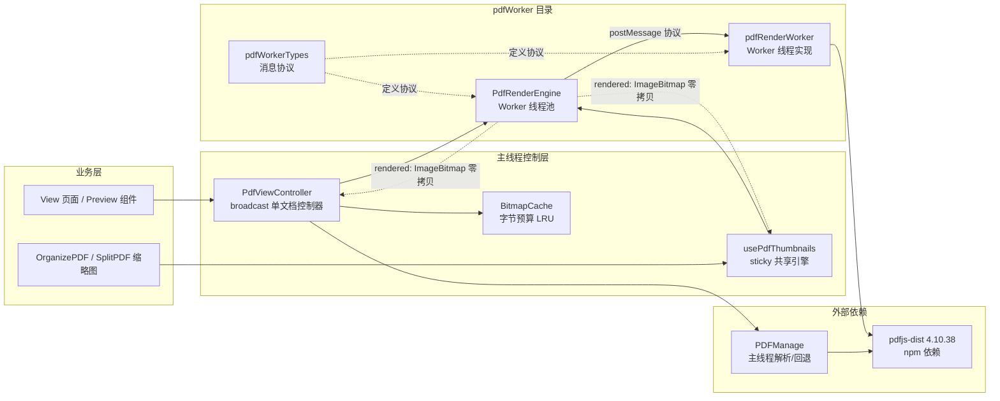
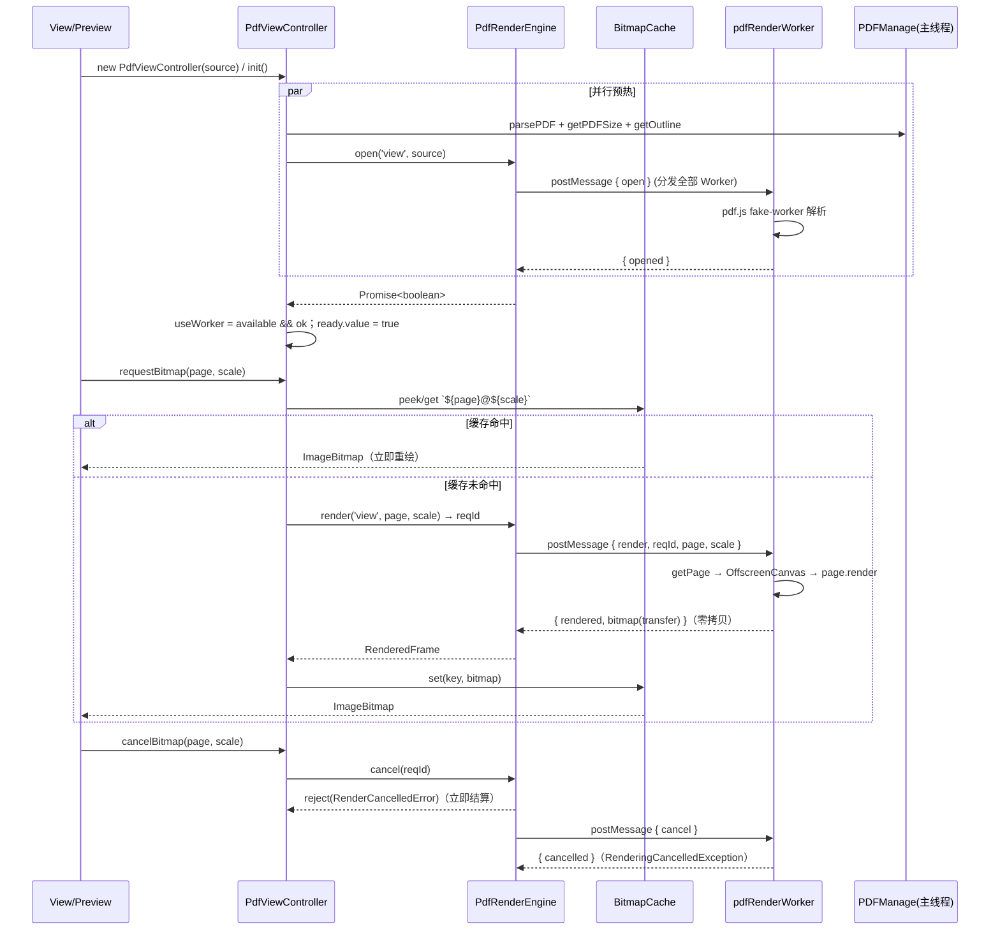
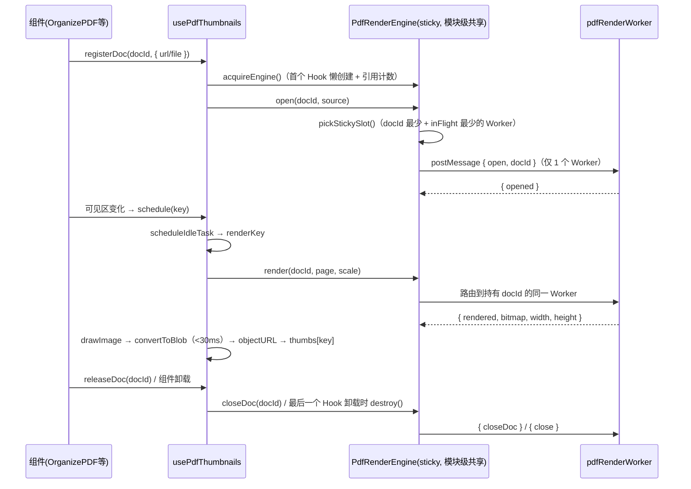

# pdfWorker 目录架构分析

> 本文档分析 `pdfWorker` 目录下各模块的作用、职责与交互关系，并说明其与外部模块（`utils/pdfRender.ts`、`hooks/usePdfThumbnails.ts` 等）的集成方式。

## 一、目录定位与总体设计

`pdfWorker` 是 **PDF 栅格化的 Worker 基础设施层**：把 pdf.js 的「解析 + 解码 + 栅格化」从主线程移入 Web Worker 线程池，主线程只拿回零拷贝传输的 `ImageBitmap`，从而避免单页 1~10s 的栅格化阻塞 UI（卡帧、滚动掉帧）。

整体遵循一条清晰的分层契约：



五个文件的职责一句话概括：

| 文件 | 职责 | 运行位置 |
| --- | --- | --- |
| `pdfWorkerTypes.ts` | 主线程 ↔ Worker 的消息协议、数据源类型、缩放换算常量 | 编译期共享契约 |
| `pdfRenderWorker.ts` | Worker 线程内部实现：pdf.js fake-worker 模式解析 + OffscreenCanvas 栅格化，多文档 LRU 管理 | Worker 线程 |
| `PdfRenderEngine.ts` | 主线程侧 Worker 池：双模式（broadcast / sticky）、负载均衡、请求跟踪、取消与销毁 | 主线程 |
| `BitmapCache.ts` | 字节预算 LRU 位图缓存，管理 `ImageBitmap` 生命周期（显存释放） | 主线程 |
| `PdfViewController.ts` | `/view` 单文档场景的共享视图控制器：串联 PDFManage + 引擎 + 缓存 | 主线程 |

---

## 二、模块逐一分析

### 2.1 `pdfWorkerTypes.ts` —— 消息协议（共享契约）

**职责**：定义主线程与 Worker 之间的全部消息类型，是两端的「共同语言」。

**内容要点**：

- **`CSS_PT_RATIO = 0.75`**：CSS px ↔ PDF pt 的换算系数（96 / 72）。与 `PDFManage.renderPage` 中 `scale / 0.75` 的约定完全一致——调用方传入的 `scale` 是「逻辑缩放」，Worker 内部再除以 0.75 得到栅格化 viewport。
- **`PdfWorkerSource`**：数据源二选一——远程 `url`（Worker 内 ranged fetch 自取，几乎不额外占主线程内存）或本地 `data: ArrayBuffer`（每个 Worker 一份副本，主线程 transfer 后原 buffer 不受影响），外加可选 `password`。
- **请求方向（主线程 → Worker）**：`open` / `render` / `measure` / `cancel` / `closeDoc` / `close`，全部携带 `docId`（多文档身份），渲染类请求携带单调递增的 `reqId` 用于取消跟踪。
- **响应方向（Worker → 主线程）**：`opened` / `openError` / `rendered` / `measured` / `measureError` / `cancelled` / `renderError`。
- **`ResRendered` 的关键设计**：`bitmap` + `scale=1` 的逻辑宽高 **同次往返带回**，调用方无需二次 measure 往返。`bitmap` 通过 `postMessage` 第二参数 `[bitmap]` 零拷贝 transfer。

### 2.2 `pdfRenderWorker.ts` —— Worker 线程实现

**职责**：在 Worker 线程内完成 PDF 解析与页栅格化，是唯一直接操作 pdf.js 的 Worker 侧模块。

**核心设计**：

1. **fake-worker 模式注入**（本模块最关键的技巧）：
   ```ts
   ;(self as any).pdfjsWorker = { WorkerMessageHandler }
   ```
   向全局注入 `WorkerMessageHandler`（来自 npm 包 `pdfjs-dist` 的 `legacy/build/pdf.worker.mjs`），pdf.js 便在本线程内以 fake-worker 模式直接运行，解析、解码、栅格化全部留在本 Worker 内，**不再创建嵌套子 Worker**——一个 Worker = 一条 OS 线程，线程数完全可控。注意 `pdf.worker.mjs` 加载时其 `WorkerMessageHandler` 静态块会自动 `initializeFromPort(self)`（注册 message 监听并发送一条 `ready`）：该监听对无 `targetName` 的请求直接返回，且其 `ready` 消息主线程侧按 `msg.type` switch 分发会忽略，与本 worker 的消息循环互不干扰。

2. **DOM 依赖隔离**：注入 `OffscreenCanvasFactory`（替代依赖 `document` 的 `DOMCanvasFactory`，含 group / 软掩码等中间画布）与 `NoopFilterFactory`（滤镜一律返回 `'none'`，等价 pdf.js 的 `BaseFilterFactory`），并设置 `isOffscreenCanvasSupported: true`、`disableFontFace: true`、`useSystemFonts: false`、`useWorkerFetch: true`，杜绝 Worker 内任何 `document` / `FontFace` / 系统字体探测。

3. **渲染流程（`render`）**：
   - `pdf.getPage(pageNum)` → 同时取 `baseVp`（scale=1）与 `viewport`（scale / 0.75）；
   - 创建 `OffscreenCanvas` → `page.render({ canvasContext, viewport })`；
   - 渲染完成后 `canvas.transferToImageBitmap()` **零拷贝** transfer 回主线程（transfer 后画布被清空，不再使用）；
   - 附带返回 `baseVp` 的逻辑宽高（免二次 measure）。

4. **取消机制**：`renderTasks: Map<reqId, RenderTask>` 跟踪在途任务；收到 `cancel` 调用 `task.cancel()`，pdf.js 抛出 `RenderingCancelledException` 后回 `cancelled` 消息。Worker 内无 `window`，pdf.js 的 rAF 自动禁用，取消安全。

5. **多文档管理**：`docs: Map<docId, DocEntry>` 为 LRU（Map 迭代序即插入序），**上限 12**（容纳 OrganizePDF 11+ 文件粘性路由的 docId 分布）。`open` 幂等（同 docId 重复 open 直接报 `opened` 并 touch 到队尾），先占位再 await 防并发重复解析；`evictDocs` 超出上限销毁最久未用的 `PDFDocumentProxy`。

6. **CMap / 标准字体**：与 `pdfRender.ts` 完全一致的 CDN 地址，保证中文等特殊字符正常显示。

7. **消息入口**：`self.onmessage` 分发 `open / render / measure / cancel / closeDoc / close` 六类请求。

### 2.3 `PdfRenderEngine.ts` —— 主线程 Worker 池

**职责**：主线程侧的 Worker 线程池管理器，负责 Worker 生命周期、请求路由、负载均衡、取消与销毁。

**双模式设计**：

| 维度 | `broadcast`（默认） | `sticky` |
| --- | --- | --- |
| 适用场景 | `/view` 单文档（左右两侧不同分辨率同时渲染） | OrganizePDF / SplitPDF 缩略图（多文档） |
| open 分发 | 同一文档铺满全部 Worker，每个 Worker 各持一份 | 只分发给**负载最轻**的一个 Worker，仅它持有该文档 |
| render 路由 | 选在途任务最少的 Worker（最大并发） | 路由到持有该 docId 的 Worker（避免跨 Worker 重复解析） |
| 池大小 | `[2, 6]`（`BROADCAST_POOL`，与 /view 历史一致） | `[3, 6]`（`STICKY_POOL`，3 起步保证 11+ 文件较均匀分摊） |
| 本地 ArrayBuffer 副本 | 上限 ≤3（`BROADCAST_LOCAL_DATA_CAP`）控内存 | 每 docId 仅 1 份（粘到单 Worker，无副本爆炸） |
| 消费方 | `PdfViewController`（docId 固定 `'view'`） | `usePdfThumbnails`（模块级共享实例 + 引用计数） |

**关键机制**：

- **懒启动**：`ensurePool()` 首次 `open` 时创建 Worker（module worker，`new Worker(new URL('./pdfRenderWorker.ts', import.meta.url), { type: 'module' })`）。
- **`open()`**：按 docId 去重（`docs: Map<docId, DocState>`）；broadcast 用 `openOnSlot` 给每个目标 Worker 发 `open`（URL 直接复用；ArrayBuffer 先 `slice(0)` 克隆再 transfer，原 buffer 不受影响），以**一次性临时 listener** 监听 `opened/openError`；`ready = Promise.all(...).then(rs => rs.some(Boolean))`——任一 Worker 就绪即视为就绪。
- **`render()/measure()`**：分配自增 `reqId`，登记到 `pendingRender/pendingMeasure`，`inFlight++` 计入负载；返回 `{ reqId, promise }` 供调用方取消。
- **`cancel(reqId)`**：**立即结算**（reject `RenderCancelledError`）并异步通知 Worker 中止 `RenderTask`。调用方凭 `RenderCancelledError` 静默忽略。
- **`onMessage`**：`rendered` → resolve 帧；若请求已被取消或已销毁，`bitmap.close()` 丢弃防泄漏。`cancelled` / `renderError` 相应 reject。
- **`destroy()`**：reject 全部 pending、发 `close` 并 `terminate()` 全部 Worker、清空全部状态。
- **异常兜底**：`worker.onerror` 置 `slot.ready = false`，该 Worker 不再被选中；`pickStickySlot/pickRenderSlot` 都跳过非 ready 的槽位。
- **特性探测 `engineAvailable`**：模块 Worker + `OffscreenCanvas` + `transferToImageBitmap` 三者齐备才启用（模块级 IIFE 一次求值）。

### 2.4 `BitmapCache.ts` —— 字节预算 LRU 位图缓存

**职责**：管理主线程持有的 `ImageBitmap`（显存/内存资源）的生命周期。

**设计要点**：

- **键**：`${page}@${scale.toFixed(3)}`——按缩放档区分，左右两侧不同分辨率各存各的，互不踩踏。
- **LRU**：`Map` 迭代序即插入序；`get()` 命中即「删后重插」刷新到队尾；`evict()` 从队首淘汰最久未用。
- **字节预算**：按 `宽 × 高 × 4`（RGBA）估算占用，默认预算 **256MB**（300% A4 单页约 35MB，可容纳约 7 张满缩放 + 大量缩略图）。
- **显存释放**：`set` 覆盖、`delete`、`evict`、`clear` 全部调用 `bitmap.close()` 立即释放底层内存/显存——这是 ImageBitmap 与普通对象的本质区别，不 close 会泄漏。
- **至少保留 1 张**：`evict` 循环条件 `map.size > 1`，避免刚渲染好的位图立即被自己挤掉。

### 2.5 `PdfViewController.ts` —— /view 单文档共享控制器

**职责**：`/view` 页面场景的编排层。View 创建**唯一一个（非响应式）实例**，以 prop 传给左右两个 Preview 组件，实现三大共享：

1. **单次解析**：一个 `PDFManage` 提供逐页精确尺寸（虚拟滚动布局用）、大纲、打印、以及主线程回退渲染。
2. **单一渲染池**：`PdfRenderEngine`（broadcast 模式，`docId = 'view'`）线程池把栅格化移出主线程。
3. **共享位图缓存**：`BitmapCache` 按 `${page}@${scale}` 命中，左右两侧各自分辨率互不踩踏。

**关键决策与实现**：

- **为何用普通 TS 类而非 Pinia**：缓存的是二进制不透明资源（`ImageBitmap` / `PDFDocumentProxy`），响应式代理无收益且可能被 Vue 深度追踪；生命周期是「每次 View 挂载」而非全局。仅 `ready` 用一个轻量 `ref` 暴露，重数据保持非响应式。
- **`init()` 并行预热**：主线程解析（`parsePDF → getPDFSize → getOutline`）与 Worker 池 `open` 用 `Promise.all` 并行，最大化首屏速度；`useWorker = engine.available && workerOk` 决定后续走 Worker 还是回退。
- **`requestBitmap(page, scale)`**：三级路径——缓存命中直接返回；`inflight` 去重（同 key 并发只渲染一次）；未命中则 Worker 渲染或主线程回退（`PDFManage.renderPage` + `createImageBitmap`，不挂 DOM 仅取像素），完成后写入缓存。
- **`peekBitmap()`**：同步探查缓存（命中即刷新 LRU），供 Preview 在重入/缩放时立即重绘。
- **`cancelBitmap()`**：仅 Worker 路径可中止（`reqId >= 0`）；主线程回退路径无 reqId，不可中止。
- **`destroy()`**：取消全部在途 → 清缓存（close 所有位图）→ 销毁引擎（terminate 全部 Worker）→ 销毁 PDFManage。
- **`getPDFInstance()`**：暴露底层 `PDFManage` 供打印等场景（与原 `PreviewType.getPDFInstance` 一致）。

> 注：当前代码库中 `PdfViewController` 尚无页面引用（grep 仅命中自身文件），属于新引入、待接入 `/view` 页面的模块。

---

## 三、模块间交互关系

### 3.1 整体交互时序（/view 场景，broadcast 模式）



### 3.2 sticky 模式（缩略图场景）



### 3.3 回退路径（Worker 不可用）

- `engineAvailable` 为 false（无 OffscreenCanvas / transferToImageBitmap / 模块 Worker）或 `open` 失败时：
  - `/view` 场景：`PdfViewController.mainThreadRender` 用 `PDFManage.renderPage(page, scale, canvas)` 在主线程栅格化，再 `createImageBitmap` 转成与 Worker 路径一致的产物类型，调用方无感；
  - 缩略图场景：`usePdfThumbnails.renderFallback` 用 `parsePDF`（主线程 PDFManage 风格）+ `page.render` + `convertToBlob/toBlob` 兜底。

---

## 四、关键设计决策与权衡

1. **fake-worker 注入 vs 嵌套子 Worker**：pdf.js 默认会再开一个子 Worker；通过注入 `self.pdfjsWorker = { WorkerMessageHandler }` 让其在本线程内运行，实现「一个 Worker = 一条 OS 线程」，池大小与并发完全由 `PdfRenderEngine` 掌控。
2. **零拷贝 ImageBitmap transfer**：栅格化产物以 `transferToImageBitmap` + postMessage 第二参数 transfer 回主线程，避免大位图的 structured clone 拷贝；代价是必须用 `close()` 显式释放。
3. **双池模式分离**：单文档大图（/view）追求最大并发 → broadcast 铺满池 + 最少在途调度；多文档缩略图追求解析复用 → sticky 粘性绑定 + LRU 文档上限 12。
4. **两级缓存**：Worker 内按 docId 缓存解析对象（LRU 12）；主线程按 `${page}@${scale}` 缓存位图（字节预算 LRU 256MB）。层级互补：前者省解析，后者省栅格化。
5. **缩放语义统一**：`CSS_PT_RATIO = 0.75` 与 `PDFManage` 的 `scale / 0.75` 约定一致，Worker 与主线程回退产出的尺寸完全对齐。
6. **取消语义**：主线程 `cancel()` 立即 reject（UI 不等待），Worker 异步中止 `RenderTask`；调用方以 `RenderCancelledError` 类型区分「取消」与「错误」。
7. **内存防护层层叠加**：本地 ArrayBuffer 副本上限（broadcast ≤3）→ Worker 内文档 LRU 12 → 主线程位图字节预算 + `close()` 即时释放 → 取消/销毁路径上所有在途位图 `close()` 丢弃。

---

## 五、生命周期与资源释放全景

| 资源 | 持有者 | 释放时机 |
| --- | --- | --- |
| `PDFDocumentProxy`（主线程） | `PDFManage` | `PdfViewController.destroy()` → `manage.destroy()` |
| `PDFDocumentProxy`（Worker 内） | `pdfRenderWorker.docs` | LRU 淘汰 / `closeDoc` / `close` |
| `RenderTask`（Worker 内） | `renderTasks` | 渲染完成 / `cancel` / `close` |
| `ImageBitmap`（主线程缓存） | `BitmapCache` | 覆盖写 / 淘汰 / `clear`（均 `close()`） |
| 在途请求 promise | `PdfRenderEngine.pending*` | resolve/reject / `cancel` / `destroy` |
| Worker 线程 | `PdfRenderEngine.slots` | `destroy()`（先 `close` 再 `terminate`） |
| 缩略图 objectURL | `usePdfThumbnails.lru` | LRU 淘汰 / `releaseDoc` / `dispose`（`revokeObjectURL`） |
| 共享 sticky 引擎 | `usePdfThumbnails` 模块级 | 引用计数归零时 `destroy()` |

---

## 六、与外部模块的集成边界

- **`utils/pdfRender.ts`（PDFManage）**：主线程侧的 PDF 解析/尺寸/大纲/文本层/打印，以及 Worker 不可用时的回退渲染。`PdfViewController` 依赖它做单次解析与回退；`usePdfThumbnails` 的 fallback 也复用其 `parsePDF`。两处 CMap / 标准字体 URL 与 pdf.js 配置（`rangeChunkSize: 65536`、`disableAutoFetch: true`）保持完全一致。
- **`hooks/usePdfThumbnails.ts`**：sticky 模式引擎的**唯一**消费方。模块级共享单例 + 引用计数（多 Hook 共池，最后一个卸载时销毁）；在引擎之上叠加空闲调度、JPEG 编码、objectURL 缓存与 LRU 淘汰。
- **`pdfjs-dist`（npm 依赖，版本 4.10.38，统一使用 legacy 构建）**：legacy 构建内联 core-js polyfill 并做语法降级，解决旧版 Safari 兼容问题（如 `Promise.withResolvers` 在 Safari 17.4 以下缺失，会导致现代构建直接报错无法加载 PDF）。主线程侧 `utils/pdfRender.ts`、`utils/fileVerification.ts` 通过 `GlobalWorkerOptions.workerSrc` 指向 `legacy/build/pdf.worker.min.mjs`；Worker 侧 `pdfRenderWorker.ts` 直接 `import { WorkerMessageHandler } from 'pdfjs-dist/legacy/build/pdf.worker.mjs'` 注入 fake-worker。两侧共用同一份 pdf.js 代码，保证行为一致。
- **`components/VirtualGrid.vue` / `hooks/useVirtualGrid.ts` / `useGridLayout.ts`**：间接消费方——虚拟滚动的可见 key 集合驱动缩略图调度，`PdfViewController` 提供的逐页精确尺寸支撑变高列表布局。

---

## 七、总结

`pdfWorker` 目录实现了一套完整的「主线程无阻塞 PDF 渲染」体系：

- **`pdfWorkerTypes.ts`** 定义契约，两端编译期对齐；
- **`pdfRenderWorker.ts`** 用 fake-worker 注入 + OffscreenCanvas 把 pdf.js 完整塞进单线程 Worker，零拷贝回传位图；
- **`PdfRenderEngine.ts`** 以双模式线程池承接两种典型负载（单文档大图 / 多文档缩略图），提供负载均衡、取消、销毁；
- **`BitmapCache.ts`** 以字节预算 LRU 精细管理显存级资源；
- **`PdfViewController.ts`** 面向 `/view` 页面做顶层编排，与 `usePdfThumbnails` 形成两个对称的接入范式。

设计上贯彻了「资源显式释放、并发受控、失败可回退」三条主线，同时保证 Worker 路径与主线程回退路径在缩放语义和产物类型上完全对齐，使上层组件对「渲染发生在哪个线程」零感知。
